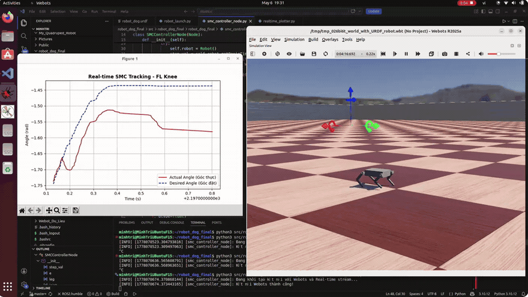
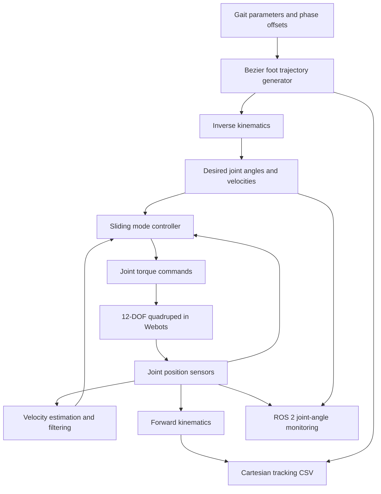

# Quadruped Robot Simulation and Control Using Sliding Mode Control (SMC)

**ROS 2 · Webots · Python · Nonlinear Control · Robot Kinematics · Trajectory Planning**

Academic team project (3 members), March–May 2026 — Control Engineering and Automation, Ho Chi Minh City University of Technology (HCMUT), VNU-HCM.

## 1. Simulation Demo



*Quadruped locomotion in simulation. This project has not been validated on physical hardware.*

## 2. Project Overview

This project develops a simulation-based locomotion and joint-torque control system for a 12-degree-of-freedom quadruped robot. The objective is to generate coordinated foot trajectories, convert them into joint-space references, and track those references using Sliding Mode Control (SMC).

The implementation includes:

- A four-legged robot model with three revolute joints per leg (hip yaw, hip pitch, and knee pitch).
- Forward and inverse kinematics for Cartesian foot-position tracking.
- Sixth-degree Bézier trajectory generation with configurable gait timing.
- Joint-level SMC with approximate gravity compensation, saturation-based switching, and filtered velocity feedback.
- ROS 2 and Webots integration, live joint-angle visualization, and Cartesian tracking data logging.

## 3. System Architecture



The main controller reads simulated joint sensors, computes reference angles using inverse kinematics, and applies torque through the Webots motor API. Forward kinematics reconstructs the measured foot position for comparison against the reference trajectory.

## 4. Methodology

### Robot kinematics

Each leg is modeled using three joint angles and the following geometric parameters in the main controller:

| Parameter | Value |
|---|---:|
| Hip offset | 0.08 m |
| Thigh length | 0.20 m |
| Shank length | 0.20 m |
| Total actuated joints | 12 |

Inverse kinematics maps a desired Cartesian foot position to joint angles. Forward kinematics performs the reverse mapping using measured angles. The implementation uses separate lateral signs for left and right legs and clips trigonometric inputs to valid numerical ranges.

### Foot trajectory generation and gait planning

The main controller generates periodic foot trajectories with seven control points and a sixth-degree Bézier polynomial:

$$
\mathbf{p}(u)=\sum_{i=0}^{6}\binom{6}{i}(1-u)^{6-i}u^i\mathbf{P}_i,\qquad 0\leq u\leq 1
$$

The polynomial is evaluated using a coefficient matrix, with gait-dependent step length, height, frequency, duty factor, and phase offsets. A three-second initialization phase gradually lowers the desired foot positions before locomotion begins.

| Gait | Phase offsets (FL, FR, RL, RR) |
|---|---|
| Trot (default) | 0, 0.5, 0.5, 0 |
| Walk | 0, 0.5, 0.25, 0.75 |
| Crawl | 0, 0.5, 0.25, 0.75 |
| Pace | 0, 0.5, 0, 0.5 |
| Bound | 0, 0, 0.5, 0.5 |
| Pronk | 0, 0, 0, 0 |

These are gait configurations present in the source, not evidence that every gait has been validated for stable locomotion. An experimental greeting pose is also included. The alternative `smc_plugin.py` implements a separate trot controller with a quadratic Bézier swing trajectory and linear stance trajectory.

### Sliding Mode Control

For each joint, the tracking error and sliding variable are defined as:

$$
e=q_d-q,\qquad \dot e=\dot q_d-\dot q
$$

$$
s=\dot e+\lambda e
$$

The implemented torque law is a simplified joint-level SMC with motor inertia and damping terms, a bounded switching term, and approximate gravity compensation:

$$
\tau=J_m\lambda\dot e+B_m\dot q+K\,\text{sat}(s/\Phi)+\tau_g
$$

Here, `sat` clips its argument to the interval [-1, 1]. The final torque command is clipped to [-30, 30] N·m. The saturation function is used to mitigate chattering; velocity feedback is estimated using finite differences and low-pass filtering.

| Main controller parameter | Value |
|---|---:|
| Sliding-surface gain, lambda | 35.0 |
| Switching gain, K | 15.0 |
| Boundary-layer parameter, Phi | 40.0 |
| Velocity filter coefficient | 0.6 |
| Motor inertia parameter | 0.001 |
| Motor damping parameter | 0.005 |

The alternative plugin has its own gains and trajectory implementation. The controller is not a full coupled floating-base dynamics or whole-body balance controller; no formal robustness or stability guarantee is asserted here.

### ROS 2 monitoring

| Topic | Purpose |
|---|---|
| `/FL_knee/actual` | Measured front-left knee angle |
| `/FL_knee/desired` | Desired front-left knee angle |
| `/smc_error` | Sum of absolute joint errors in the alternative plugin |

The main controller records desired and reconstructed front-left foot positions to CSV. The standalone Matplotlib plotter subscribes to the first two topics to visualize joint tracking during simulation.

## 5. Experimental Results

Tracking metrics were calculated from the committed [Cartesian tracking log](robot_dog_final/smc_data_FL_cartesian.csv). The first three seconds of initialization were excluded (3,838 of 4,837 samples retained; simulation time 3.000–14.511 s).

| Tracking metric | Error |
|---|---:|
| X-axis RMSE | 1.93 cm |
| Y-axis RMSE | 0.80 cm |
| Z-axis RMSE | 1.15 cm |
| 3D position RMSE | **2.39 cm** |
| Mean Euclidean position error | 1.55 cm |

The 3D position RMSE is defined as the square root of the mean squared Euclidean distance between desired and reconstructed positions:

$$
\mathrm{RMSE}_{3D}=\sqrt{\frac{1}{N}\sum_{k=1}^{N}\|\mathbf{p}_{d,k}-\mathbf{p}_{a,k}\|_2^2}
$$

These results describe one recorded simulation of the front-left foot, in the coordinate convention of the kinematics code. They do not establish whole-body stability, tracking accuracy for all four legs, robustness across disturbances, or physical robot performance. No new simulation run was performed to produce these statistics.

## 6. Repository Structure

```text
robot_dog_final/
├── launch/
│   └── robot_launch.py          # Webots and main controller launch
├── protos/
│   └── robot_dog.proto          # Webots robot model
├── resource/
│   ├── robot_dog.urdf           # Robot description
│   └── robot_dog.proto          # Additional copy of the PROTO model
├── robot_dog_final/
│   ├── smc_controller_node.py   # Main SMC, gait generation, IK/FK and logging
│   ├── smc_plugin.py            # Alternative Webots controller plugin
│   ├── realtime_plotter.py      # ROS 2 joint tracking visualization
│   └── smc_data_FL_cartesian.csv # Recorded tracking data
├── worlds/
│   └── quad_arena.wbt           # Webots simulation world
├── test/                       # ROS package lint tests
├── package.xml
├── setup.py
└── setup.cfg
```

## 7. Technologies

- **Programming:** Python, NumPy
- **Robotics and simulation:** ROS 2 (`rclpy`, `std_msgs`), Webots, `webots_ros2_driver`, URDF, PROTO
- **Control and planning:** Sliding Mode Control, forward/inverse kinematics, Bézier curves, gait phase coordination
- **Monitoring and analysis:** Matplotlib, CSV data logging

## 8. Getting Started

Use a compatible ROS 2 installation, Webots (the world references R2025a assets), the Webots ROS 2 driver, NumPy, Matplotlib, and `colcon`. The exact ROS distribution is not specified in the repository.

Example setup in a sourced ROS 2 environment on Linux:

```bash
mkdir -p ~/quadruped_ws/src
cd ~/quadruped_ws/src
git clone https://github.com/trilehoangminh-source/robot_dog_final.git
cd ~/quadruped_ws
rosdep install --from-paths src --ignore-src -r -y
colcon build --packages-select robot_dog_final
source install/setup.bash
ros2 launch robot_dog_final robot_launch.py
```

To start the plotter in a separate sourced terminal:

```bash
cd ~/quadruped_ws
source install/setup.bash
python3 src/robot_dog_final/robot_dog_final/realtime_plotter.py
```

The plotter is invoked directly because `setup.py` registers only the main SMC node as a console executable. Ensure NumPy and Matplotlib are installed in the Python environment used by ROS 2. The Webots controller connection and robot configuration must match the local installation. The launch commands above were derived from the package files, but have not been executed in this review.

## 9. Project Status and Future Work

- Evaluate gait stability and foot tracking across all four legs and multiple simulation runs.
- Investigate disturbance rejection and compare SMC with alternative joint controllers.
- Extend the joint-level controller toward whole-body dynamics and balance control.
- Improve reproducibility through dependency documentation and repeatable simulation tests.
- Explore future deployment on a physical quadruped robot.

## 10. Team and Acknowledgments

**Le Hoang Minh Tri and project teammates** — academic team of three, March–May 2026.

Control Engineering and Automation, Ho Chi Minh City University of Technology (HCMUT), VNU-HCM.

GitHub: [trilehoangminh-source](https://github.com/trilehoangminh-source)

Thanks to the ROS 2 and Cyberbotics Webots communities for their robotics software, documentation, and simulation tools.

The work described here represents the team project; individual contributions are not separately attributed. The repository's `setup.py` lists Apache-2.0, but `package.xml` contains a placeholder license declaration and no standalone LICENSE file was found. Confirm the intended license and third-party asset permissions before redistribution.
